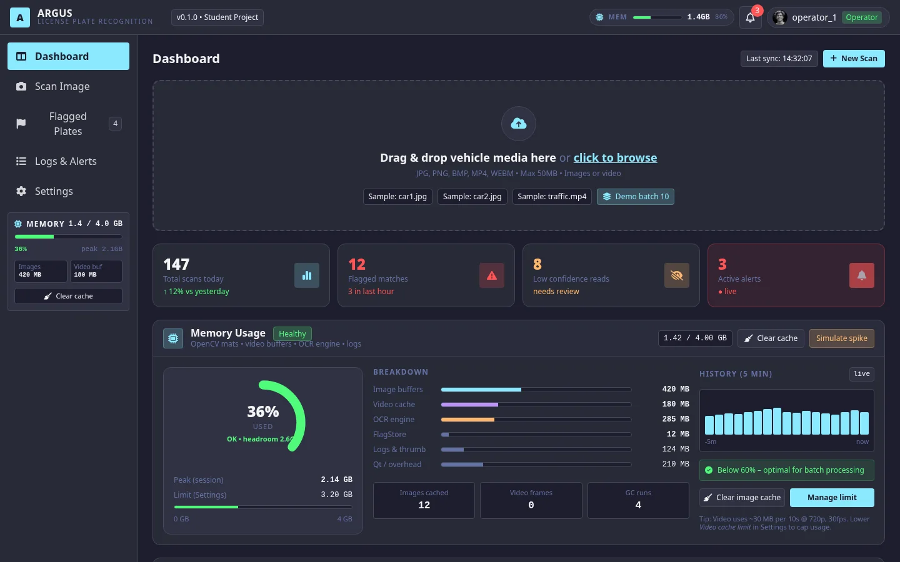

# Argus

**License plate recognition and flagging prototype for authorized, offline lab work.**

[Live UI mockup](https://nyght-x-walker.github.io/argus/) · [C++ prototype notes](Argus/README.md) · [Architecture](ARCHITECTURE.md)



## What it does

Argus explores a complete ANPR workflow: load an image or video frame, detect a plate, run OCR, normalize and validate the text, check a watchlist, raise an alert on a match, and keep an audit-friendly log.

The repository contains two related surfaces:

- A public HTML/Tailwind UI mockup that locks the layout and operator flow before the C++ implementation.
- A C++17/openFrameworks desktop prototype that implements the detection, OCR, validation, watchlist, and logging pipeline.

## Stack

`C++17` `openFrameworks 0.12` `ofxImGui` `OpenCV` `Tesseract 5` `SQLite` `HTML / Tailwind`

## Run the C++ prototype

The build requirements and exact steps live in [`Argus/README.md`](Argus/README.md). In short:

```bash
cd Argus
make
./bin/Argus
```

## Status and limitations

This is a student project, not a production ANPR system.

- Detection is a contour heuristic and can miss plates until OCR-backed validation improves.
- Validation covers one EU generic plate shape; US and UK formats are future work.
- The watchlist is exact-match on normalized text.
- Small or angled plates read poorly.

## Live mockup

The UI mockup is deployed at [nyght-x-walker.github.io/argus](https://nyght-x-walker.github.io/argus/). It is a static HTML/Tailwind prototype, separate from the C++ desktop app.
